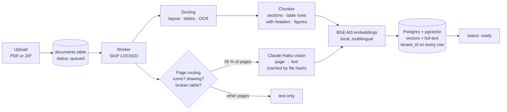
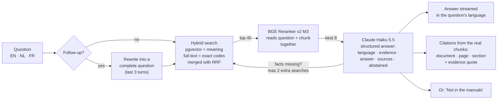
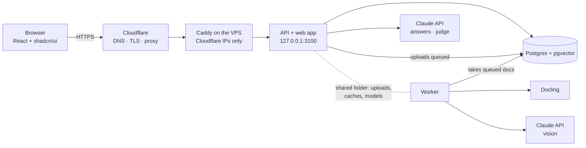

# Debrief notes: Ask the Manual

My own notes for the debrief. Live: https://highsail-task.lernie.net · Code: github.com/etichisom/high-sail-task

---

## 1. The 30-second pitch

A field technician asks a question about a heat pump or a plant room, in English, Dutch or French, often with typos.
The service answers **in the language of the question**, **cites the document and PDF page** for every fact, and says
**"not in the manuals"** instead of guessing. Wrong answers are worse than no answer, so the system is built to
refuse when the evidence is missing.

Results on the 21 dev questions: **18–19/21 correct** (it varies a little per run), the right page found in 94–100 %,
the right page cited in ~94 %. On 20 extra questions I wrote and checked myself and never tuned on: 20/20.
About **$0.0013 per question**, **p50 ~11 s, p95 ~18 s** on a CPU, one-time ingest cost **$0.26** for the whole pack.

---

## 2. Architecture

### Ingestion: once per document, in the background worker



### Answering: every question



### Where it runs



---

## 3. Why I chose each piece

| Choice | Why | What I compared / rejected |
|---|---|---|
| **TypeScript + Node** | One language for API, worker, CLI and web app; strong types for the JSON shapes. | Python would have been fine; I wanted one stack end to end. |
| **Docling** (Docker) for PDF → structure | Keeps headings, tables (rows + headers), pictures, and does OCR for the scan. Plain text extraction loses table structure. | pdftotext: tables became word soup. Docling ran out of memory on the 180-page De Dietrich manual, so I convert in **parts of 30 pages** and merge. |
| **Own chunker** on Docling's JSON | One chunk per section; long tables split between rows **with the header repeated**, so every chunk is understandable alone. Every chunk starts with the manual's name. | Fixed-size chunks cut tables in half. |
| **Claude Haiku vision on some pages only** | Icons, the P&ID drawing and broken tables are not in the text layer. Vision turns them into words ("suitcase with a clock → holiday mode"). A routing rule picks only the pages that need it (231 of 585, 39 %). | Vision on every page: ~2.5× the cost for no gain. Cached by file hash, so it is paid once. |
| **BGE-M3 embeddings**, local (Transformers.js, 8-bit) | Multilingual: a Dutch question finds an English or French page. Runs on CPU, free, no data leaves the server. | Paid embedding APIs: cost per call and another dependency. |
| **Postgres + pgvector** | Vectors, full-text search, the tenants, users, documents and chats in **one database**. `tenant_id` on every row. | A separate vector DB would add a service for 3,400 chunks. |
| **Hybrid search + RRF** | Vectors find meaning ("vakantie" = "holiday"); full-text finds exact codes (F12, H62, V-202) that embeddings blur. RRF merges both rank lists without tuning weights. | Vector only: missed exact error codes. |
| **Reranker** (BGE Reranker v2 M3, local) | A cross-encoder reads question + chunk together: much more precise. Moved the right page from #12–#35 to the top. **+9 points.** | Shorter reranker input and batching: faster but changed the ranking or was slower on CPU. |
| **Claude Haiku 5.5 to answer** | Measured, not assumed: Haiku with the agent 90 %; Sonnet without agent 57 % at 12× the cost; Sonnet with agent 52 % (kept searching). Failures came from what the model *sees*, not how smart it is. | Sonnet, Opus. |
| **Structured output** | Claude must return JSON: language, evidence, answer, source numbers, abstained. No parsing of free text; citations come from the source numbers. | Free text + regex: fragile. |
| **Small agent (search tool, max 2 extra searches)** | When the first results miss, Claude searches again with better words in the manual's language (Dutch question → French De Dietrich manual). | No agent: cross-language questions failed. |
| **Claude Sonnet 5.5 as eval judge** | Same verdict as Opus on all 21 questions at half the price. Only used in the eval. | Opus. |

---

## 4. The code: what each part does

```
src/ingest/      docling.ts      PDF → Docling JSON (cached by file hash, big PDFs in parts of 30 pages)
                 chunk.ts        Docling JSON → chunks (sections, table rows with headers, figure text)
                 needs-vision.ts which pages go to vision (routing rules)
                 vision.ts       page → PNG (pdftoppm) → Claude Haiku → markdown (cached)
                 vision-chunks.ts vision markdown → small chunks under their headings
                 embed-chunks.ts BGE-M3 vectors for chunks that have none yet
                 pipeline.ts     the full ingest for one PDF; "ready" only if every step worked
src/retrieval/   embed.ts · hybrid-search.ts (vector + full-text + RRF) · rerank.ts
src/answer/      ask.ts          the agent: prompt rules, search tool, structured output, citations, cost,
                                 follow-up rewriting, answer streaming
src/eval/        evaluate.ts     one question: ask + checks + judge
                 summary.ts      the report (counts, p50/p95, cost) and the question-file check
                 jobs.ts         evals started from the web app (background, one at a time)
src/api/         server.ts       HTTP API (plain node:http): login, upload, ask, stream, chats, evals, web app
                 upload.ts       PDF/ZIP checks and saving
src/worker/      index.ts        the queue worker
src/auth/        passwords (scrypt) · sessions (cookie) · accounts (sign-up, log-in)
src/chat/        conversations.ts saved chats + context for follow-ups
web/             React + shadcn/ui app: chat, documents, evaluation, login
db/schema.sql    tenants, users, sessions, documents, chunks, conversations, messages
```

---

## 5. Uploads, the queue and the worker

1. **Upload** (`POST /documents`, the Documents page): a PDF or a ZIP of PDFs.
   Checks: only real PDFs (file signature), size limits, ZIP path tricks refused, at most 100 PDFs per ZIP.
   The file is saved under its **sha256** name, and a `documents` row is created with status **queued**.
   **Same file again → skipped** (duplicate), so adding one manual never re-processes the others.
2. **The queue is the `documents` table itself** (no Redis needed). The worker takes the oldest queued row with
   `UPDATE … WHERE id = (SELECT … FOR UPDATE SKIP LOCKED LIMIT 1)`: **several workers can run** and never take the
   same document.
3. **Crash safety**: while working, a worker holds a **Postgres advisory lock** on that document. If it crashes,
   Postgres drops the lock; at the next start, a "processing" document with a free lock goes back to the queue.
4. **Pipeline per document**: Docling → chunks → vision pages → embeddings, with progress written to the row
   ("page 3/10", "embedding"). Status **ready** only at the very end; any error → **failed** with the message.
5. The web app polls the list every 3 s while something is queued or processing.

---

## 6. Answering: the rules that make it trustworthy

- **Only the sources**: every fact from a numbered source; values never from Claude's own knowledge.
- **Evidence first**: Claude must copy the exact line/table row it uses. If it cannot, it does not have the answer.
- **Label check**: a value must mean what was asked (a set point is not a minimum, MCA is not a breaker size).
- **Every part** of a multi-part question needs evidence, or it searches again.
- **Named brand only**: a question about EcoFlow is never answered with Midea values.
- **Field words ↔ manual words**: "breaker size" = MFA, "debiet" = flow rate (knowledge used only to match terms).
- **Direct answer first**: the first sentence is the answer + which manual; then complete numbered steps (each test
  and what to do with its result). No list of manuals that do *not* cover it.
- **Abstain**: if the specific fact is not in the sources, say so in one sentence in the question's language.
- **Citations** are built from the chunks Claude used: real document + page, never generated text.
- **Follow-ups**: "and the pressure switch?" is first rewritten by Haiku into a complete question for the search;
  the last 3 turns go along as context.

---

## 7. Evaluation: how it works

`npm run eval -- --tenant demo [--file questions.json] [--runs 3]`, or the **Evaluation** page in the app.

For every question it runs the **real pipeline**, then measures:

| Metric | How |
|---|---|
| **Correct** | Claude Sonnet compares the answer with the reference: correct / partial / wrong. Only "correct" counts. Unanswerable questions: correct = it abstained. |
| **Retrieval recall** | Was a right page among the retrieved chunks at all? Separates search failures from answer failures. |
| **Citation** | Did the answer cite a right page (exact, and within ±1 page)? |
| **Exact number check** | Which numbers of the reference appear in the answer (decimal comma = dot). A rough second signal. |
| **Abstention** | Accuracy, precision, recall; how many hallucinated (answered an unanswerable) and wrongly abstained. |
| **Language** | Is the answer text in the question's language? Detected from the answer words (en/nl/fr), not Claude's own label. |
| **Latency** | p50 / p95 / max, plus time per step: search, reranker, Claude. |
| **Tokens + cost** | Real token counts × the price list, per question; judge cost shown separately. |

Every run is saved as `store/eval/results-<time>.json`. Counts are shown as "18/21", not just %, because the set is
small: one question is ~5 points. `--runs 3` shows flaky questions.

**How the score grew** (dev set): 38 % baseline → 48 % vision → 57 % reranker → 62 % all 9 manuals →
76 % agent + keyword fix → 81 % evidence + term matching → 86–90 % vision v2, small chunks, manual names, label rules.

**The known misses (honest)**
- **dev-05 (max glycol %)** is labelled "not covered", but the Midea manual says "never exceed 35 %" (PDF p41). The
  question names no brand; the label seems to assume a Panasonic. The system answers 35 % and names the Midea manual.
- **dev-19 (valve between buffer tank and 3-way valve)** is ambiguous: the P&ID has two 3-way valves next to the
  buffer tank (TV-201 and MV-401). It finds the right drawing but sometimes picks the other valve.
- **dev-04 (H62 steps)** is flaky: correct about 2 runs in 3; the judge wants the full flow-switch test.
- Fix for the first two in a product: the app knows which installation the technician stands at.

---

## 8. Cost

| | Cost |
|---|---|
| Docling, embeddings, reranker | $0 (run locally) |
| Vision at ingest, 231 pages, once | $0.26 (~$0.001/page), cached by file hash |
| Per question (Haiku, 1–3 calls, ~9–11k input tokens) | ~$0.0013 |
| Follow-up rewrite | +~$0.0001 |
| Eval judge (Sonnet), whole dev set | ~$0.04 per run |
| Whole dev eval run | ~$0.07 |

Cost is computed from the **real token counts** in every response × the price list (`costUsd()` in ask.ts).

---

## 9. Latency

Average per question: search 0.3 s, **reranker ~8 s**, Claude ~4 s in 1.3 turns. The reranker runs on CPU and is
the bottleneck; on a GPU it is well under 1 s (→ ~4–5 s per answer). The answer **streams**, so the technician
sees text after the search, not after the whole answer. Changes tried: 20 instead of 40 candidates on extra
searches, effort "low" (same score, ~1 s faster): p50 12.4 s → ~10–11 s.

---

## 10. Multi-tenant and security

- Every table has `tenant_id`; every query filters on it. The company comes **from the session**, never from the
  request body or URL.
- Passwords: **scrypt**. Session: random UUID in an **HttpOnly, SameSite=Lax, Secure** cookie. Failed logins
  rate-limited (10 per 15 min per email).
- Chats are per user; a chat id of another user returns 404.
- Uploads: real-PDF check, size limits, ZIP path tricks refused, files stored by hash.
- Text from manuals goes onto the page as text, never as HTML.
- Server: only reachable through Cloudflare; Postgres and Docling have no public port.

---

## 11. Hosting

- **VPS** (Hetzner, 4 vCPU, 7.5 GB RAM) with **Docker Compose**: `db` (Postgres + pgvector), `docling`, `api`
  (API + React app), `worker`. Memory limits so Docling cannot take the whole machine (Docling 4 GB, PDFs in
  parts of 10 pages there).
- **Caddy** in front: `highsail-task.lernie.net` → `127.0.0.1:3100`, answers only Cloudflare's IP ranges,
  streaming flushed immediately.
- **Cloudflare** proxy for DNS, TLS and protection (uploads up to 100 MB on the free plan).
- The 9 manuals were processed on my laptop and the database + caches copied, so no re-processing on the server.
- Guide: `docs/deploy.md`. Update: `git pull && docker compose -f docker-compose.prod.yml up -d --build`.

---

## 12. Scaling to 500 companies × 10,000 documents

- **Database**: one pgvector table with `tenant_id` + HNSW index (with iterative scan for filtered search), or
  partitions per tenant for the biggest ones. ~5 M chunks fits Postgres well.
- **Ingest**: the queue already supports many workers (SKIP LOCKED); run more of them, Docling on bigger machines.
- **Uploads**: presigned URLs straight to a bucket (S3/R2), the API never holds the file.
- **Cost**: vision once per unique file (hash cache, ~$0.001/flagged page); answers ~$0.0013.
- **Speed**: reranker on GPU (or a hosted reranker); cache answers to repeated questions.
- **Quality**: eval set per release; monitor abstention rate, latency, cost and 👍/👎 from the saved messages.

---

## 13. Likely questions and my answers

**Why not just put all the PDFs in Claude's context?** 585 pages per company, ×500 companies: too expensive per
question, slower, and citations to exact pages get harder. Retrieval sends ~8 small chunks: $0.0013 per question.

**How do you stop hallucinations?** Answers only from numbered sources; Claude must copy the evidence line first;
label checks; it abstains when the fact is missing; citations come from the real chunks, not from the model.
Measured: abstention precision/recall in every eval.

**Why is the score not 100 %?** Two of the misses are about the labels/ambiguity (dev-05, dev-19), one is flaky.
I prefer to show that honestly; I did not tune the prompt to the dev set wording, and the 20 extra test questions we wrote ourselves scored 20/20.

**How do you know the judge is fair?** I read the failures by hand, compared Sonnet with Opus (same verdicts on all
21), and added an exact number check and a "partial" grade so it is not too generous.

**Why Haiku and not a bigger model?** I measured it: a bigger model scored lower or the same, at 12× the cost.
The problems were retrieval (what it sees), so I fixed retrieval.

**How does it handle Dutch questions about French manuals?** BGE-M3 is multilingual, the reranker too, and the agent
searches again in the manual's own language using the manuals list.

**How do icons and the P&ID work?** Page routing sends those pages to Claude vision once at ingest; the
transcription describes icons in words and lists P&ID components with tags and connections, then gets embedded
like normal text.

**What happens if the worker crashes mid-document?** The advisory lock is released; the next start puts it back in
the queue. A document is "ready" only when every step worked.

**How do you add a document without re-processing the others?** Each file is identified by its sha256; existing
files are skipped, and Docling/vision results are cached by hash.

**What is slow and how would you fix it?** The reranker on CPU (~8 s). GPU or hosted reranker → ~4 s total.

**What would you do with another week?** Installation context (the technician picks the site/unit, which removes the
ambiguity), evidence quote shown under each answer, 👍/👎 feedback, a bigger test set from real questions,
bucket uploads, reranker on GPU.

**How is the data of one company kept from another?** tenant_id on every row and every query, company taken from the
login session only, chats per user. Tested: another company's cookie sees nothing, a forged cookie gets 401.

**How would you run their held-out set right now?** `npm run eval -- --tenant demo --file their-questions.json`, or
drop the JSON on the Evaluation page.

---

## 13b. Stretch goals (all four done)

- **Comparison of approaches with numbers**: the score progression table (38 → 48 → 57 → 62 → 76 → 81 → 86–90 %)
  and Haiku vs Sonnet (90 % vs 57 % / 52 %, 12× the cost). Every number is an eval run.
- **More precise citations**: section/table/figure name on each citation + the evidence quote (exact source line)
  under each answer.
- **Follow-up questions**: saved chats, follow-up rewritten into a complete question, last 3 turns as context.
- **New document without re-processing**: sha256 per file, duplicates skipped, Docling + vision cached by hash.

## 14. Demo script (5 minutes)

1. Log in → **Documents**: 9 manuals, status ready, upload box (PDF or ZIP).
2. **New chat**: "f12 op de buitenunit, wat moet ik checken" → streams, Dutch, citation chips with section names,
   and the "From the manual" evidence quote.
3. Follow-up: "and where is the pressure switch?" → understood from context.
4. "how long is the warranty?" → **Not in the manuals**.
5. A pictogram question ("mitsubishi ecodan screen has a little suitcase…") → vision at work.
6. **Evaluation** → run the dev set (or show the last run): correct, recall, citations, abstention, p50/p95, cost.
